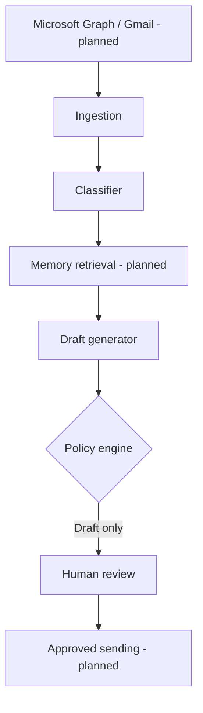

# MailMind 🧠📬

**An open-source, human-supervised AI email assistant.**

MailMind is a modular framework for email intelligence, draft generation, contextual memory, human approvals, and multichannel notifications.

> **Current status: foundation prototype.** This version exposes a synthetic email analysis API and deterministic draft suggestions. It does not connect to live mailboxes, call an LLM, or send messages.

## Architecture



## Quickstart

Requires Python 3.12+.

```bash
git clone https://github.com/milajoselyn/mailmind-agent.git
cd mailmind-agent
python -m venv .venv
source .venv/bin/activate
pip install -e ".[dev]"
cp .env.example .env
uvicorn mailmind.main:app --reload
```

On Windows activate using `.venv\Scripts\activate`.

```bash
curl -X POST http://127.0.0.1:8000/v1/analyze \
  -H "Content-Type: application/json" \
  -d '{"message_id":"demo-1","sender":"jordan@example.com","subject":"Meeting request","body":"Can we schedule a meeting on Friday?"}'
pytest
```

The endpoint uses a deterministic prototype classifier. No messages are sent, and no results persist across restarts.

## Roadmap

- [x] FastAPI foundation, typed models, deterministic classification
- [x] Draft-only default and synthetic unit tests
- [x] CI, security guidance and coding-agent instructions
- [ ] Microsoft Graph and Gmail OAuth
- [ ] PostgreSQL, tenant isolation and durable queues
- [ ] LLM adapters and provenance-based memory
- [ ] Verified approval and outbound sending
- [ ] Teams, Slack, SMS, WhatsApp integrations
- [ ] Importable n8n workflows and production deployment

See [architecture](docs/ARCHITECTURE.md), [build instructions](prompts/BUILD_AGENT.md), and [security policy](SECURITY.md).

MIT licensed. Contributions welcome.
